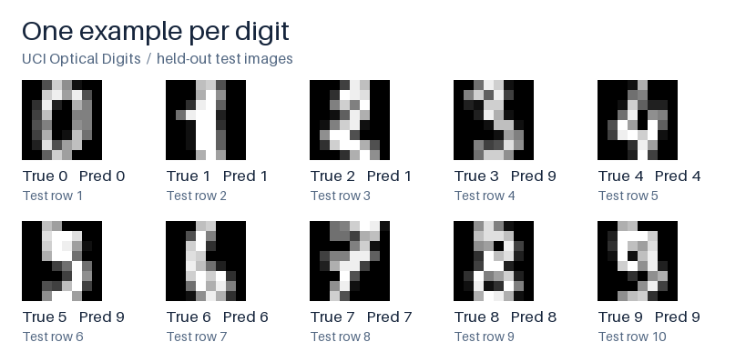
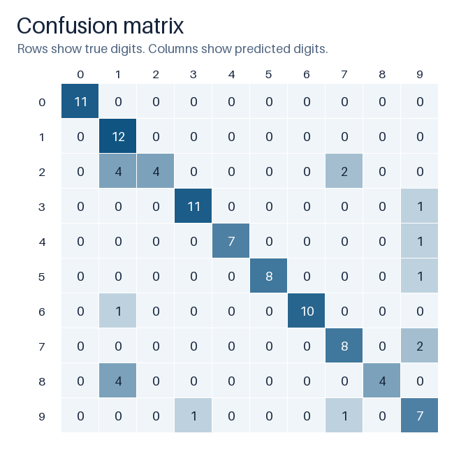

# Handwritten digit recognition · baseline results

A 3-nearest-neighbors classifier recognized **82 of 100 held-out handwritten digits**. This folder documents a standalone baseline run on UCI Optical Digits. The evaluation used the first 200 rows of the official training file and the first 100 rows of the official test file. These figures apply only to that subset.



## Results

| Test images | Correct | Misclassified | Accuracy | Macro F1 |
| ---: | ---: | ---: | ---: | ---: |
| 100 | 82 | 18 | 82% | 0.814 |



[Inspect all 18 misclassified images](misclassified_digits.png). Each caption gives the one-based test row so you can find the same image in the predictions table and source data.

## Output files

| File | Contents |
| --- | --- |
| [predictions.csv](predictions.csv) | True digit, predicted digit, and correctness for each test image |
| [classification_report.csv](classification_report.csv) | Precision, recall, F1, and test count for each digit |
| [metrics.json](metrics.json) | Overall accuracy, macro F1, and sample counts |
| [confusion_matrix.csv](confusion_matrix.csv) | Counts behind the confusion matrix |
| [sample_predictions.png](sample_predictions.png) | First test example of each true digit from 0 through 9 |
| [misclassified_digits.png](misclassified_digits.png) | Every incorrect prediction |
| [confusion_matrix.png](confusion_matrix.png) | Visual breakdown of predictions by digit |

## Reproduce the run

From this folder, run the following commands with Python 3.10 or later and an internet connection.

```sh
python -m pip install "Pillow>=10.1"
python reproduce.py
```

The script reads two public UCI files, uses the 64 supplied pixel features for each 8 × 8 digit, and ranks training images by squared Euclidean distance. The three closest images vote on the predicted digit. A tied vote goes to the closest tied label. The script regenerates the tables and images in this folder.

## Data

E. Alpaydin and C. Kaynak, *Optical Recognition of Handwritten Digits*, UCI Machine Learning Repository. [Dataset and attribution](https://doi.org/10.24432/C50P49).
